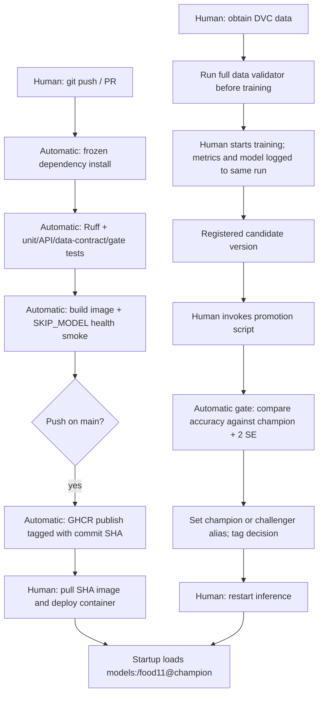

# Lab 5 answers

1. A real model adds network/server availability, registry alias state, missing artifacts, and GPU/dependency compatibility to unit tests. Those can fail independently of correct API code. Tests use a fake model and skip registry loading.
2. The API test checks image decoding, the normalized input's shape, class mapping, softmax and response confidence. It does not establish real classification accuracy or registry availability. The fake returns log probabilities because the real model returns logits.
3. The cross-split content hash check catches the copied image. Leakage contaminates evaluation and can silently exaggerate accuracy; corrupted images are usually visible as decoding failures. The existing mini dataset itself contains 43 later-split duplicate files; the validator correctly fails on it.
4. Run validation after `dvc pull` on a runner that can access the remote, and locally/on the training machine before starting training. CI uses a synthetic dataset to test the validator, without downloading private DVC data.
5. `smoke` is skipped if `test` fails. Without `needs`, it could run concurrently and succeed despite failing unit tests.
6. Two successful runs took 2m51s and 2m47s. Their uv sync steps took 6s and 5s; smoke took 113s and 109s. Caching is enabled and avoids repeated downloads, but these small differences are not a controlled cold-cache benchmark. Links and measurements: `ci-results.json`.
7. A SHA identifies a specific code revision. With `latest`, one machine can keep yesterday's cached image while another pulls today's image under the same tag. SHA tags support reproducible deployment and rollback.
8. The publishing job only gets package write and content read. An unnecessarily broad token could let a compromised action modify code or other repository resources.
9. Main now requires a PR and passing test/smoke checks, including for administrators. PR #1 showed blocked with failed checks. The intended unit-test failure also skipped smoke. After correction, both required checks passed and the PR showed clean. This enforces shared checks instead of relying on local habits. Evidence: `ci-results.json`.
10. Baseline version 1 scored 52.6066% on 1,055 evaluation images. The margin was 3.0746 percentage points, giving a 55.6812% promotion threshold. Version 2 (lr=0.000001, 3 epochs) scored 12.5118% and became challenger. Version 3 (lr=0.0001, 5 epochs) scored 77.2512% and became champion. Both decisions and all inputs are model-version tags. See `local-results.json`.
11. Run the gate as the next step in a training job on a machine with MLflow access, or use a self-hosted Actions runner on that network. A hosted MLflow service also allows a cloud runner with credentials to reach it.
12. The diagram below shows automatic CI and the remaining training/deployment decisions.

Code version is chosen by the image's commit SHA; model version is chosen by the champion alias at startup. Publishing does not automatically deploy the image or reload the model.

## Local evidence

- 15 tests passed; Ruff passed; Compose configuration passed; all Docker images built.
- The original mini dataset failed only the split leakage check (43 duplicate pairs, listed in `lab/data-validation.txt`).
- `clean_data.py` created `data/food11_processed_mini_clean` without modifying the original. This copy passes all five checks and has 1,055 evaluation images. Use this same copy for baseline and candidates.
- Real frontend upload, Staging reload and volume persistence passed.
- Three GPU training runs and both promotion decisions completed; champion is version 3.
- GitHub test/smoke checks passed after the intentional failure was fixed. Branch protection and timings are recorded in `ci-results.json`.
