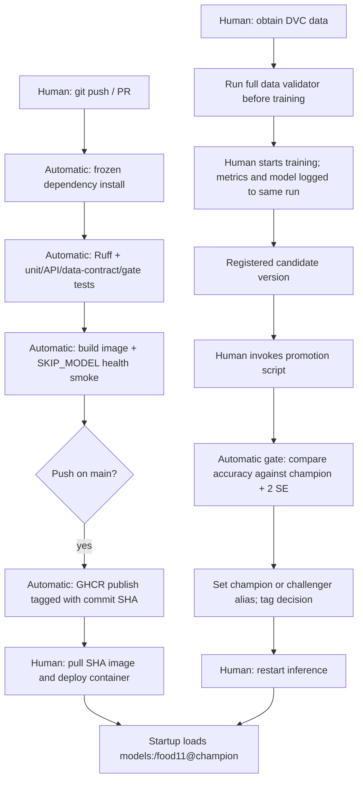

# Lab 5 answers

1. A real model adds network/server availability, registry alias state, missing artifacts, and GPU/dependency compatibility to unit tests. Those can fail independently of correct API code. Tests use a fake model and skip registry loading.
2. The API test checks image decoding, the normalized input's shape, class mapping, softmax and response confidence. It does not establish real classification accuracy or registry availability. The fake returns log probabilities because the real model returns logits.
3. The cross-split content hash check catches the copied image. Leakage contaminates evaluation and can silently exaggerate accuracy; corrupted images are usually visible as decoding failures. The existing mini dataset itself contains 43 later-split duplicate files; the validator correctly fails on it.
4. Run validation after `dvc pull` on a runner that can access the remote, and locally/on the training machine before starting training. CI uses a synthetic dataset to test the validator, without downloading private DVC data.
5. `smoke` is skipped if `test` fails. Without `needs`, it could run concurrently and succeed despite failing unit tests.
6. Actual GitHub timings require two workflow runs. Record each run's duration and `uv sync` duration in Actions. Dependency caching should reduce downloads on subsequent runs; this document does not invent measurements.
7. A SHA identifies a specific code revision. With `latest`, one machine can keep yesterday's cached image while another pulls today's image under the same tag. SHA tags support reproducible deployment and rollback.
8. The publishing job only gets package write and content read. An unnecessarily broad token could let a compromised action modify code or other repository resources.
9. With required PRs and required `test`/`smoke` checks, a deliberately failing PR shows failed checks and blocks normal merging. Exceptions depend on administrator bypass settings. This enforces a shared gate rather than relying on developers remembering local tests. This repository setting and PR experiment have not been performed here.
10. Run `promote.py` on two newly trained registered versions and record its printed numbers. The margin is `2 * sqrt(p * (1-p) / n)`; multiply by 100 for percentage points. Use the evaluation size matching the champion's evaluation data. No real candidate results have been fabricated.
11. Run the gate as the next step in a training job on a machine with MLflow access, or use a self-hosted Actions runner on that network. A hosted MLflow service also allows a cloud runner with credentials to reach it.
12. The diagram below shows automatic CI and the remaining training/deployment decisions.

Code version is chosen by the image's commit SHA; model version is chosen by the champion alias at startup. Publishing does not automatically deploy the image or reload the model.

## Local evidence

- 14 tests passed; Ruff passed; Compose configuration passed.
- The original mini dataset failed only the split leakage check (43 duplicate pairs, listed in `lab/data-validation.txt`).
- `clean_data.py` created `data/food11_processed_mini_clean` without modifying the original. This copy passes all five checks and has 1,055 evaluation images. Use this same copy for baseline and candidates.
- Docker image builds were started; downloads are slow. Real container predictions, real training/promotion results, GitHub Actions timings and branch protection experiments are not yet verified.
